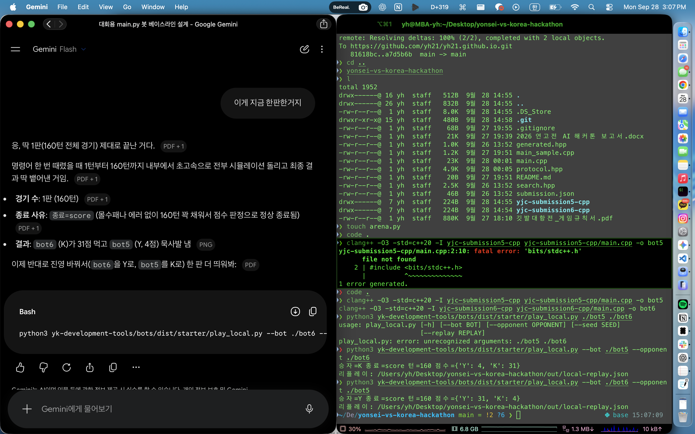
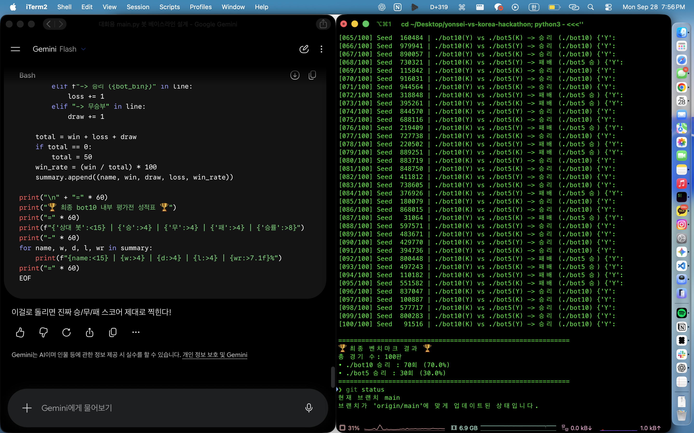
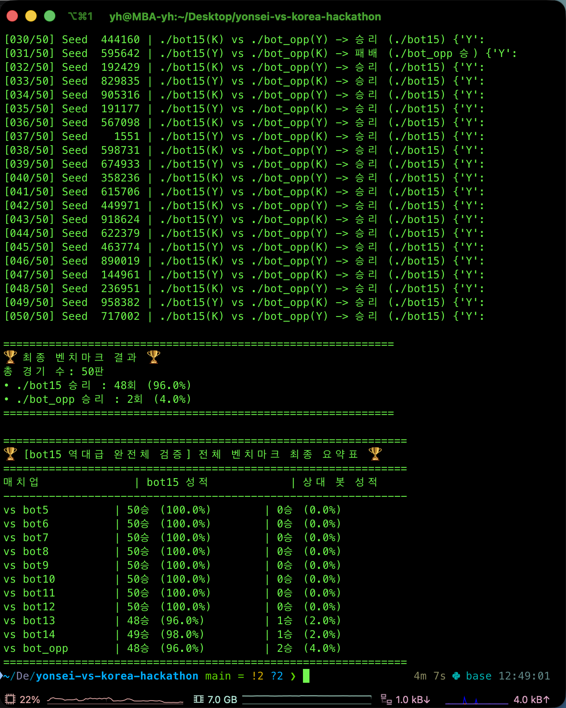

A project built during the **2026 Yonsei vs Korea University AI Hackathon**, together with my team **양진장**. We wrote a bot for a turn-based strategy game called *Flag Battle* (깃발 대항전) and finished **15th** in the final tournament with **31 wins and 17 losses** (64.6% win rate over 48 matches).

### Overview

The game is played on a 15×15 map for 160 turns, and each turn the bot has 300ms to answer. Both teams give orders at the same time. There are three unit types:

- **Flag units** capture buildings.
- **Combat units** fight, and cancel out one-for-one.
- **Scouts** move two tiles at a time and reveal scores.

The map has 17 buildings with different effects, such as extra income, capture discounts, cheaper combat units, teleporting stations and score reveals. A match ends early if one side is wiped out of points while the other holds a majority. Otherwise it is decided by score at turn 160.

Our agent has no neural network and uses only the C++ standard library. The whole submission is a single source ZIP of about 40KB.

**How it plays**

- A **policy** generates candidate plans: risk-weighted paths, target assignment, capture-cost reservation and production decisions.
- A **local search** rolls each candidate out in a simulator that copies the game engine's turn processing, and keeps the best combination.
- The bot guesses which of several opponent behavior models has been predicting best so far, and plans against that one. On the real server this prediction accuracy was very low (around 0.07), so I added decisions that stay safe even when the guess is wrong, like repairing flag positions and evaluating the opponent's best counterattack.
- A search turn is capped at 50ms. The server ran about 7× slower than my laptop, so compute budget directly decided how strong the bot was on the server.

### How it evolved

I did not design the final bot in one go. I kept shipping a new version every few hours, about 50 in total, and measured each one against the older ones before keeping it.

| Versions | What changed |
| :-- | :-- |
| v5 – v14 | Starting from the sample code, simple policies and benchmark scripts |
| v17 – v20 | Simulator ported from the game engine, local search over candidate plans, opponent model selection |
| v21 – v27 | Faster opening, big CPU savings with identical behavior, deterministic sorting, raid pass, goal tuning |
| v28 – v29 | Stronger enemy-flag hunting, economy emergency mode, safer flag position repair |
| v30 – v36 | Teammate work: exact simultaneous-arrival calculation, worst-case counterattack evaluation |
| v50 – v51 | Final tuning of defense and recapture parameters for the two economy buildings |

The first thing I did was run the starter bots against each other to make sure a full 160-turn match worked end to end.

After that, almost everything became a benchmark loop. I wrote `benchmark.py` to play two bots many times with the sides swapped, so a result could not come from starting on a lucky side.

Later versions were checked against all earlier ones to catch regressions. Here v15 beats every older bot, though it still lost a couple of games to an opponent I had made.

### Results

| Version | Real server record | Leaderboard rank |
| :-- | :-- | :-- |
| v20 | 15W 9L | 10th |
| v27 | 7W 5L | 20th |
| v28 | 13W 11L | 27th |
| v50 | 13W 11L | 15th |
| **Final tournament** | **31W 17L (64.6%)** | **15th** |

An interesting detail is that the win rate in my local simulations stayed around 54 to 63%, but the rank kept going up. Since the tournament is Swiss-style and pairs teams with similar ranks, progress showed up in the rank more than in the win rate.

One caveat: my practice opponents were variants of my own bots, so simulated results do not carry over to the real server perfectly. For the final version (v51) I could not separate its effect on the real server, because the result screen does not show which version played.

### Tech Stack

- **Language:** C++20, standard library only (server: gcc 12.2, 384MiB memory)
- **Tooling:** Python (`benchmark.py` and the provided local runner) for self-play benchmarks
- **Checks before adopting a change:** server-speed simulation, re-testing on fresh seeds, ASan/UBSan, a 60ms stress test, and the official self-check
- **AI assistance:** I used Claude (Claude Code) for writing code, analyzing replays, automating candidate evaluation and safety checks. Every change was still verified with the benchmarks above before I adopted it.

### Key Takeaways

- **Strong on my laptop is not strong on the server.** The server was about 7× slower, so I built a server-speed simulation first. Only after that could I tell which changes actually helped.
- **Treat noise honestly.** The same bot could swing by around 40 games out of 120, so I paired comparisons in the same time window, re-tested on new seeds, and did not accept small differences.
- **Top teams kept their economy buildings.** Holding them, especially the engineering building, was the common strength of the better teams. I could not fully copy this, and changing the opening unit placement is left as the next thing to try.
- Shipping a new version every few hours and benchmarking it against the old ones was a better workflow than trying to design the perfect bot first.

The code and the full write-up are in the [repository](https://github.com/yh21/yonsei-vs-korea-hackathon).
